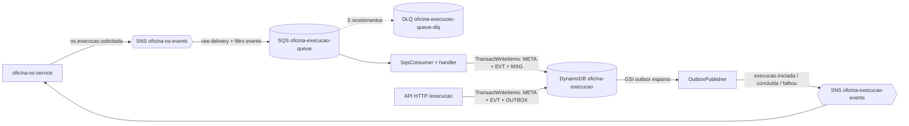
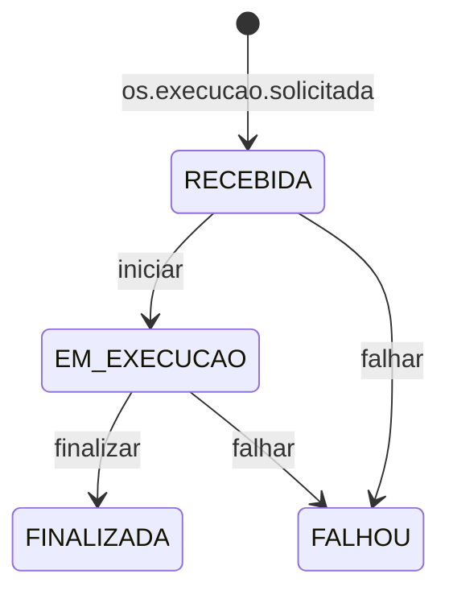

# oficina-execucao-service

[](https://sonarcloud.io/project/overview?id=guimullerdev_oficina-execucao-service)
[](https://sonarcloud.io/project/overview?id=guimullerdev_oficina-execucao-service)

Tech Challenge Fase 4 - microsserviço de execução e produção da oficina (NestJS 11, DynamoDB em tabela única, SNS/SQS), participante da saga orquestrada pelo `oficina-os-service`.

## Sumário

1. [O que é](#1-o-que-é)
2. [Arquitetura](#2-arquitetura)
3. [Por que DynamoDB](#3-por-que-dynamodb)
4. [Contrato de eventos](#4-contrato-de-eventos)
5. [Máquina de estados](#5-máquina-de-estados)
6. [API](#6-api)
7. [Configuração](#7-configuração)
8. [Rodando localmente](#8-rodando-localmente)
9. [Testes e cobertura](#9-testes-e-cobertura)
10. [CI/CD e deploy](#10-cicd-e-deploy)
11. [Dívidas técnicas](#11-dívidas-técnicas)

## 1. O que é

O Execução e Produção cuida da fila de trabalho da oficina: recebe o pedido de execução de uma OS, mantém o estado da execução (recebida, em execução, finalizada ou falhou) e avisa o OS do resultado. Ele não decide o andamento da saga: reage ao comando que chega por SNS/SQS e responde publicando eventos.

No saga do OS ele é o passo `EXECUTAR`:

| Passo da saga | Entrada (do OS) | Ação do Execução | Saída (para o OS) |
|---|---|---|---|
| Executar | `os.execucao.solicitada` | cria a execução `RECEBIDA` na fila | - |
| Iniciar | `PATCH /execucao/:osId/iniciar` (staff) | `RECEBIDA` para `EM_EXECUCAO` | `execucao.iniciada` |
| Finalizar | `PATCH /execucao/:osId/finalizar` (staff) | `EM_EXECUCAO` para `FINALIZADA` | `execucao.concluida` |
| Falhar | `PATCH /execucao/:osId/falhar` (staff) | `RECEBIDA`/`EM_EXECUCAO` para `FALHOU` | `execucao.falhou` |

## 2. Arquitetura



Módulos em `src/`:

| Módulo | Responsabilidade |
|---|---|
| `modules/execucao` | domínio da execução, casos de uso, repositório DynamoDB, controller e handler de `os.execucao.solicitada` |
| `modules/auth` | `JwtAuthGuard` (JWT validado com `JWT_SECRET`), `RolesGuard`, decorators `@Public` e `@Roles`; as rotas de negócio exigem perfil staff (`ADMIN`, `ATENDENTE`, `MECANICO`) |
| `modules/health` | `GET /execucao/health` |
| `shared/dynamodb` | cliente DynamoDB, chaves da tabela única (`keys.ts`) e `DynamoTransaction` (TransactWriteItems) |
| `shared/messaging` | `OutboxWriter`, `OutboxPublisher`, consumidor SQS, registro de handlers e `IdempotentProcessor` |

O módulo `execucao` segue as camadas:

- `domain`: entidade `Execucao` (transições de estado), `ExecucaoStatus`, ordenação da fila e erros de transição/conflito;
- `application`: casos de uso `iniciar`, `finalizar`, `falhar`, `consultar` e o `AutoConcluirService` (opcional);
- `infrastructure`: `ExecucaoRepository` (DynamoDB);
- `http`: `ExecucaoController`, `ConflictFilter` (conflito de estado vira 409) e `FalharDto`;
- `messaging`: `ExecucaoSolicitadaHandler`.

## 3. Por que DynamoDB

O desafio exige ao menos um banco NoSQL entre os microsserviços; o Execução é o serviço que usa DynamoDB (o Billing usa PostgreSQL). O acesso é por chave (por OS, pela fila e pelo outbox), sem joins nem ORM e sem migrations: a tabela é criada pelo Terraform.

Tabela única `oficina-execucao` (PAY_PER_REQUEST, chaves `PK` e `SK`, strings):

| Item | PK | SK | Atributos principais |
|---|---|---|---|
| `META` (execução) | `OS#<osId>` | `META` | `osId`, `status`, `prioridade`, `dataAbertura`, `sagaId`, `correlationId`, `ordem`, `nome`, `causadoPor`, `atualizadoEm`, `GSI1PK`, `GSI1SK` |
| `EVT` (linha do tempo) | `OS#<osId>` | `EVT#<iso>#<uuid>` | `tipo` (status), `detalhe` (motivo/descrição), `criadoEm` |
| `MSG` (idempotência) | `MSG#<eventId>` | `MSG` | `evento`, `processadoEm`, `correlationId` |
| `OUTBOX` | `OUTBOX#<id>` | `OUTBOX` | `id` (vira `eventId`), `evento`, `aggregateType`, `aggregateId` (osId), `payload`, `correlationId`, `traceparent`, `createdAt`, `OUTBOX_PK`/`OUTBOX_SK` (enquanto pendente), `publicadoEm` |

Índices secundários globais (projeção `ALL`):

| GSI | Chaves | Uso |
|---|---|---|
| `fila` | `GSI1PK = FILA`, `GSI1SK = <status>#<prioridade com 3 dígitos>#<dataAbertura>` | lista as execuções (`GET /execucao/fila`); a ordenação final (em execução, recebida, falhou, finalizada; mais antigas primeiro) é feita em memória |
| `outbox` (esparso) | `OUTBOX_PK = PENDENTE`, `OUTBOX_SK = createdAt` | só itens pendentes aparecem no índice; o publisher remove `OUTBOX_PK`/`OUTBOX_SK` depois do publish confirmado |

**Atomicidade do estado e do evento.** Cada mudança de estado é uma única `TransactWriteItems`: `UpdateItem` do `META` com condição `status = <anterior>`, `Put` do `EVT` e `Put` do `OUTBOX`. Ou tudo é gravado, ou nada (outbox transacional). Se a condição falha, a API devolve 409.

**Idempotência no próprio DynamoDB.** No consumo, o `IdempotentProcessor` inclui na mesma transação do handler um `Put` do item `MSG#<eventId>` com `attribute_not_exists(PK)` (o `eventId` vem do atributo da mensagem ou, na falta, do `MessageId`). Mensagem repetida é descartada: seja pela leitura consistente prévia, seja pelo cancelamento da transação por `ConditionalCheckFailed` no `MSG` (corrida entre réplicas).

**Alternativa descartada: DynamoDB Streams + Lambda.** Publicar os eventos a partir de um stream exigiria uma Lambda e permissões extras, e deixaria o publish fora do ciclo de vida do serviço. Preferimos o outbox transacional com um relay (`OutboxPublisher`) dentro do serviço, no mesmo padrão do Billing, e a idempotência fica na própria tabela em vez de depender de infraestrutura adicional.

## 4. Contrato de eventos

**Entrada.** Fila `oficina-execucao-queue`, assinada em `oficina-os-events` com entrega raw e filtro de atributo `evento = os.execucao.solicitada`. A policy da fila só aceita envio desse tópico. Falha do handler não remove a mensagem: ela reaparece após o visibility timeout e, depois de 3 recebimentos, vai para `oficina-execucao-queue-dlq`.

| Evento | Payload |
|---|---|
| `os.execucao.solicitada` | `{ "id": "<osId>", "sagaId": "<sagaId>", "ordem": <n>, "nome": "<texto>", "causadoPor": "<texto>" }` |

O handler cria o `META` (`RECEBIDA`, prioridade 0) e o primeiro `EVT`, sem gerar evento de saída.

**Saídas.** Tópico `oficina-execucao-events` (criado pelo `oficina-infra-k8s`, aqui só referenciado por ARN). A mensagem SNS é o `payload` em JSON, com `osId` e `id` (ambos iguais ao id da OS) e `sagaId`:

| Evento | Payload |
|---|---|
| `execucao.iniciada` | `{ osId, id, sagaId }` |
| `execucao.concluida` | `{ osId, id, sagaId }` |
| `execucao.falhou` | `{ osId, id, sagaId, motivo }` |

Atributos SNS de cada mensagem (todos `String`):

| Atributo | Valor |
|---|---|
| `evento` | nome do evento |
| `eventId` | id do item OUTBOX (chave de deduplicação para o consumidor) |
| `correlationId` | repassado do comando `os.execucao.solicitada` (gravado no `META`) |
| `traceparent` | só quando disponível |

**Duplicatas.** Mensagem com `eventId` já processado é confirmada (ack) sem efeito. O mesmo comando reenviado com outro `eventId` para uma OS que já tem execução também é ack sem efeito: o `META` existente não é sobrescrito e só o novo `eventId` é registrado.

## 5. Máquina de estados



Qualquer outra transição (por exemplo finalizar uma execução `RECEBIDA`, ou iniciar uma `FINALIZADA`) responde 409. `falhar` exige `motivo` não vazio. A mesma garantia vale com réplicas concorrentes, pela condição `status = <anterior>` da transação.

## 6. API

Prefixo global `/execucao`. Swagger em `/execucao/docs`. As rotas de negócio exigem JWT (HS256, validado com `JWT_SECRET`) com role `ADMIN`, `ATENDENTE` ou `MECANICO`.

| Método | Path | Auth | Respostas |
|---|---|---|---|
| GET | `/execucao/health` | pública | 200 `{ "status": "ok" }` |
| GET | `/execucao/fila` | JWT staff | 200 (execuções ordenadas); 401; 403 |
| GET | `/execucao/:osId` | JWT staff | 200 (execução e linha do tempo); 401; 403; 404 |
| PATCH | `/execucao/:osId/iniciar` | JWT staff | 204; 401; 403; 404; 409 (transição inválida) |
| PATCH | `/execucao/:osId/finalizar` | JWT staff | 204; 401; 403; 404; 409 |
| PATCH | `/execucao/:osId/falhar` | JWT staff | 204 (corpo `{ "motivo": "<texto>" }`); 400 (motivo ausente/vazio); 401; 403; 404; 409 |

Produção (API Gateway):

- Swagger: https://7eu2kz40xj.execute-api.us-east-1.amazonaws.com/prod/execucao/docs
- Health: https://7eu2kz40xj.execute-api.us-east-1.amazonaws.com/prod/execucao/health

## 7. Configuração

"Onde": `configmap` (`k8s/configmap.yaml`), `secret` (Secret `oficina-execucao-service-secret`, criado pelo CI a partir dos secrets do GitHub) ou `.env` (`.env.example`, só local).

| Nome | Onde | Descrição |
|---|---|---|
| `PORT` | configmap / .env | porta HTTP (3000) |
| `NODE_ENV` | configmap / .env | `production` no cluster; com `test` publisher e auto-conclusão não iniciam |
| `AWS_REGION` | configmap / .env | região dos clientes AWS (`us-east-1`) |
| `AWS_ENDPOINT_URL` | .env | endpoint do LocalStack; ausente no cluster (AWS real) |
| `AWS_ACCESS_KEY_ID`, `AWS_SECRET_ACCESS_KEY` | secret / .env | chave do usuário IAM do pod (CI: `POD_AWS_ACCESS_KEY_ID`/`POD_AWS_SECRET_ACCESS_KEY`); `test`/`test` no LocalStack |
| `DYNAMODB_TABLE` | configmap / .env | nome da tabela (`oficina-execucao`) |
| `SNS_TOPIC_ARN` | secret / .env | tópico `oficina-execucao-events`; sem ele o publisher não inicia |
| `SQS_QUEUE_URL` | secret / .env | fila `oficina-execucao-queue`; sem ela o consumidor não inicia |
| `JWT_SECRET` | secret / .env | segredo dos JWT (mesmo valor do OS); o deploy falha sem ele |
| `SQS_CONSUMER_ENABLED` | configmap / .env | `true` liga o consumidor SQS (qualquer outro valor desliga) |
| `OUTBOX_PUBLISHER_ENABLED` | configmap / .env | `false` desliga o publisher do outbox |
| `OUTBOX_POLL_MS` | configmap / .env | intervalo da varredura do outbox (2000 ms) |
| `OUTBOX_BATCH` | configmap / .env | itens por lote do outbox (25) |
| `SQS_WAIT_TIME_SECONDS` | opcional | long poll (padrão 20) |
| `SQS_VISIBILITY_TIMEOUT_SECONDS` | opcional | visibility timeout do receive (padrão 30) |
| `SQS_MAX_MESSAGES` | opcional | mensagens por poll (padrão 10, máx. 10) |
| `EXECUCAO_AUTO_CONCLUIR_MS` | configmap / .env | atraso do poller de auto-conclusão; vazio ou 0 = desligado (mínimo 500 quando ligado). Desligado em produção (`""` no configmap) |

## 8. Rodando localmente

```bash
yarn install
cp .env.example .env
docker compose up -d        # LocalStack (SNS, SQS, DynamoDB) em :4566
yarn start                  # API em http://localhost:3000/execucao (Swagger em /execucao/docs)
```

O LocalStack executa `scripts/localstack/init.sh` ao subir: cria os tópicos `oficina-os-events` e `oficina-execucao-events`, a fila `oficina-execucao-queue` com a DLQ `oficina-execucao-queue-dlq`, a assinatura com o filtro de `evento`, a fila espiã `oficina-execucao-events-spy` (recebe tudo o que o serviço publica) e a tabela `oficina-execucao` com os GSIs `fila` e `outbox`. A porta é a mesma dos LocalStack dos outros serviços: rode só uma stack por vez.

Fluxo completo de teste (precisa de `docker`, `curl`, `jq`, `node` e do `JWT_SECRET` igual ao da aplicação):

```bash
BASE_URL=http://localhost:3000 JWT_SECRET=change-me scripts/localstack/smoke-execucao.sh
```

O script publica `os.execucao.solicitada` no SNS, confere `RECEBIDA`, tenta finalizar (409), inicia (204), finaliza (204), lê os eventos na fila espiã, confere `FINALIZADA` e a linha do tempo e verifica que a DLQ está vazia.

## 9. Testes e cobertura

```bash
yarn lint:ci       # eslint --max-warnings=0 (usado no CI)
yarn build         # nest build
yarn test          # jest
yarn test:cov      # jest --coverage; falha abaixo de 80% (statements, branches, functions, lines)
```

- Threshold global de 80% em statements, branches, functions e lines (`package.json`). A cobertura exclui `*.module.ts`, `main.ts`, `*.dto.ts` e `*.spec.ts`; o relatório vai para `coverage/`.
- Sonar: projeto `guimullerdev_oficina-execucao-service` (`sonar-project.properties`). O passo do CI só roda com o secret `SONAR_TOKEN` e usa a variável de repositório `SONAR_ORGANIZATION`, com `sonar.qualitygate.wait=true`. Dashboard: https://sonarcloud.io/project/overview?id=guimullerdev_oficina-execucao-service

## 10. CI/CD e deploy

Pipeline `.github/workflows/ci-cd.yml` (push e PR em `main`; imagem e deploy só em push na `main`):

| Job | O que faz |
|---|---|
| `build-and-test` | `yarn install --frozen-lockfile`, `yarn lint:ci`, `yarn build`, `yarn test:cov`, scan Sonar (se houver `SONAR_TOKEN`) |
| `terraform-check` | `terraform fmt -check`, `init -backend=false` e `validate` em `terraform/`, sem credenciais AWS |
| `docker-build-push` | build e push para o GHCR: `ghcr.io/guimullerdev/oficina-execucao-service:<sha>` e `:latest` |
| `deploy` | environment `prod`, namespace `prod`, cluster EKS `oficina-cluster`; pulado (com aviso) sem `AWS_ACCESS_KEY_ID` |

O `deploy` cria o Secret `oficina-execucao-service-secret` (`SNS_TOPIC_ARN`, `SQS_QUEUE_URL`, `JWT_SECRET` e a chave do pod), aplica o ConfigMap, o Deployment, o Service, o Ingress e o HPA e espera o rollout. Não há Job de migration: a tabela vem do Terraform.

**Terraform** (`terraform/`, apply manual; o CI só valida): cria a fila e a DLQ (3 recebimentos), a queue policy (só `oficina-os-events` envia), a assinatura raw com filtro de `evento`, a tabela DynamoDB `oficina-execucao` (GSIs `fila` e `outbox`), a policy IAM e o usuário IAM do serviço. A access key do pod é criada fora do Terraform. Os tópicos SNS pertencem ao `oficina-infra-k8s`. Passo a passo em `terraform/README.md`.

**Kubernetes** (`k8s/`): Deployment com 2 réplicas (probes em `/execucao/health`, pods não-root), HPA de 2 a 5 réplicas (CPU 70%), Service na porta 3000 e Ingress nginx roteando só `/execucao` (sem host e sem rewrite).

Operação em janela paga (subir/derrubar o ambiente): [oficina-infra-k8s/docs/runbook-janela-paga.md](https://github.com/guimullerdev/oficina-infra-k8s/blob/main/docs/runbook-janela-paga.md).

## 11. Dívidas técnicas

- Credencial AWS do pod é uma chave IAM estática, sem IRSA.
- Não há controle de estoque/peças nem apontamento de tempo: a execução só tem o estado e a linha do tempo.
- A auto-conclusão só existe por flag (`EXECUCAO_AUTO_CONCLUIR_MS`) e está desligada em produção; a conclusão real é manual, pela API.
- Itens `MSG` e `OUTBOX` não têm TTL: crescem indefinidamente na tabela.
- Não há `supertest`: os filtros de exceção são testados sem HTTP.
